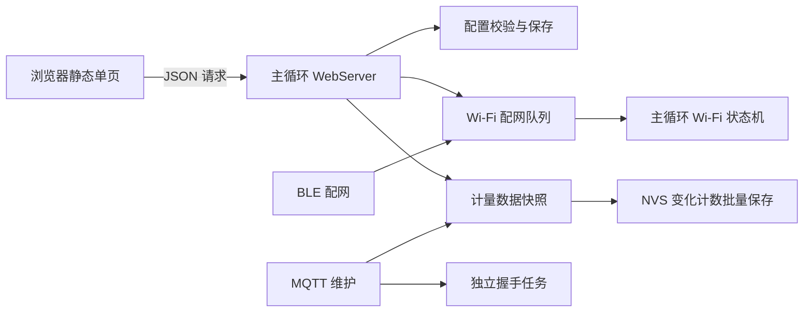

# Web 门户架构（v1.0.2）

页面与后端按 QC_ESP32 的方式分开：`web/index.html` 负责显示与交互，`scripts/embed_web.py` 在构建时生成 `include/web_assets.h`，`src/web_portal.cpp` 通过 `send_P` 发送静态页面并提供 JSON API。移除 ESPAsyncWebServer/AsyncTCP 依赖，使用 Arduino WebServer。

## 浏览器

- 一个页面包含总览、采集、Wi-Fi、MQTT/系统、OTA 五个标签；切换只调整本地显示，不发起页面请求。
- 12 路总览和配置卡片只创建一次。轮询更新数值节点，不重建整组卡片，不向配置输入框回填轮询数据。
- 首次读取 `/api/config`；失败后重试。用户输入期间不自动重载配置。配置提交采用 JSON，系统仅提交变化字段。
- `/api/status` 同一时刻至多一个请求。总览完成一次请求后间隔约 1 秒，其他标签约 5 秒；失败时退避，后台页面暂停。请求超时为 7 秒。
- 扫描由点击触发；连接弹窗保持在原页面，轮询共享配网作业的状态，而非只看 Wi-Fi 是否已经连接。

## JSON API

| 方法与路径 | 内容 |
|---|---|
| GET `/api/status` | 原有设备/Wi-Fi/MQTT/NTP/12 路电量结构，新增 uptime_ms、free_heap、ota_state、wifi.state |
| GET `/api/config` | 19 个系统配置字段与 meters 配置；密码仅在配置接口读取；禁止缓存 |
| POST `/api/config` | 部分系统配置更新，校验后保存并延迟重启 |
| POST `/api/meters` | 完整 12 路配置，可附 `zero_channel`；也支持仅清零指定通道 |
| GET `/api/wifi/scan?start=1` | 显式启动异步扫描，扫描期间返回 scanning=true |
| GET `/api/wifi/scan` | 查询扫描状态/结果，不会自行重新扫描 |
| POST `/api/wifi/connect` | `{ssid,password}`，排队成功返回 202 |
| GET `/api/wifi/status` | queued/disconnecting/connecting/connected/failed、错误与实际连接信息 |
| POST `/api/ota` | `{url,md5,size}`，校验后排队，返回 202 |
| POST `/api/reboot` | 保存待落盘计数，延迟重启 |

JSON 请求限制为 8192 字节。通道必须完整且不重复，名称限制为原有 19 个 UTF-8 字节，数值及类型先全部校验后再应用，避免最后一个字段错误时已修改前面的配置。系统配置仍使用原有 NVS 保存函数，不在本次重构中引入存储格式迁移或多键事务。

旧页面路径作为单页入口保留，`/pw?ssid=` 会打开连接弹窗。`/connect`、`/webconnect`、`/wifi_status`、`/save_meters`、`/save_mqtt`、`/ota`、`/reboot` 保留参数入口；保存/升级/重启现在可返回 JSON，`/scan_result` 返回 JSON 扫描结果，不再返回 HTML 片段。新网页只使用 `/api/*`。

## 服务与任务所有权

HTTP/DNS 与配置提交、Wi-Fi 状态机、计量汇总在 Arduino 主循环执行。BLE 回调只向长度为 1 的队列发送 SSID/密码，不在回调中写 NVS 或调用 WiFi.begin。修改配置与配网使用同一作业槽，避免并行写入；连接请求响应后再断开旧关联，确认旧关联结束后发起新连接，防止同名网络换密码时误报旧连接成功。

MQTT 的 DNS/TCP/CONNACK 握手由常驻通知任务处理，TCP 连接等待设置为 1 秒、MQTT socket 等待为 2 秒。握手时主循环的 MQTT 维护/发布/状态读取不会访问同一客户端；任务完成后以原子状态交回所有权。分配任务失败不会退回同步握手。失败重试间隔为 10 秒，使用过去时间戳相减，支持 millis 回绕。已连接后的 MQTT loop/发布仍由主循环处理。

BLE 状态重发每 100 ms 一次，共 3 次，不在主循环连续 delay。配网结果依据共享作业状态判断，排队期间仍存在的旧关联不代表新凭据成功。

计数落盘仍每 30 秒按需触发，使用原来的 `dianbiao/pulseN/pulse_ok` 键：一次打开 NVS，初始化完成后仅写变化通道，初始化标记只在首次完整写入后设置。写入失败保留 RAM 待保存状态并退避重试；清零只修改指定通道。未改变 GPIO、计量公式、脉冲过滤规则或分区表。

OTA 下载和 Flash 写入仍是显式升级期间的阻塞操作；网页会提示设备可能暂时离线。硬件射频切换、Flash 操作及已连接 MQTT 的异常 socket 仍可能影响实际响应，主机测试不等同于实板延迟测量。
