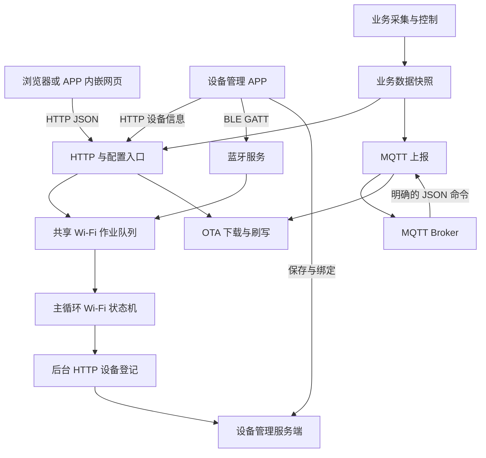
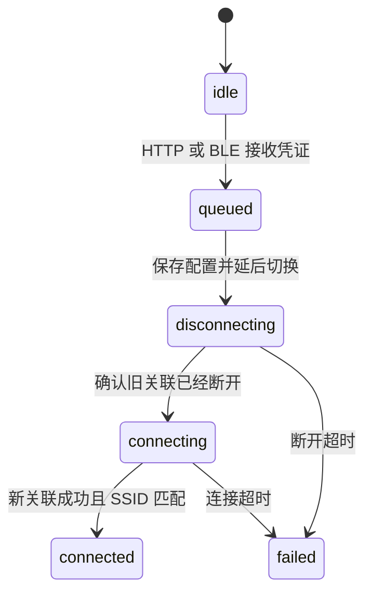

# 智能硬件通用开发指南

以 DianBiao v1.0.10 为主体，补充 QC_ESP32 v0.1.13 的设备管理接入，供后续需要 MQTT、Wi-Fi、BLE、OTA、热点 Web 配置和设备管理平台接入的项目复用。开发环境为 Windows PowerShell 7。

本文以两个项目源码为依据。除第 16 节及显式对比外，“当前实现”指 DianBiao，不能将其参数直接套用到 QC_ESP32。“新项目约定”和“建议扩展”是后续开发要求。APP 部分参考 `smart-hardware-management` 源码；后端分类校验问题已由用户确认在服务端修复，专项排查文档已移除，本次没有读取服务端修复源码或重新调用线上接口。

## 1. 如何以本项目为基础开发

后续项目保留通信、配网、配置页面和设备身份这一层，再替换传感器、执行器、采集算法及业务报文。复制工程后先完成第 3 节的项目定义，再按第 13 节逐步接入。

不要把电表的 GPIO、12 路数量、计量规则、NVS 名称、现场服务器地址直接当成所有设备的默认值。项目中仍有 `andon_*` 等历史函数名，它们在这里实际服务于电表；命名不决定协议或设备分类。

| 层次 | 可沿用的能力 | 新项目需要确定的内容 |
|---|---|---|
| 硬件与业务 | 初始化、周期处理、重启前保存的组织方式 | 芯片/Flash/PSRAM、引脚、电平、业务状态、断电数据 |
| 配置 | 默认值、NVS 加载/保存、JSON 校验 | 配置结构、命名空间、版本迁移和生效时机 |
| 通信 | Wi-Fi 作业队列、MQTT 握手任务、BLE GATT、平台 HTTP 登记 | 设备标识、Topic、业务字段、服务器和分类 |
| Web | Flash 内嵌单页、JSON API、轮询及表单交互 | 品牌标题、业务卡片、表单和状态文案 |
| 交付 | PlatformIO、固件合并、校验清单 | 正确的板型/分区、版本、升级兼容性和验收结果 |

## 2. 目录、架构与执行边界

### 2.1 源码入口

| 文件 | 职责 |
|---|---|
| [platformio.ini](../platformio.ini) | 目标硬件、平台与依赖版本、编译参数 |
| [src/main.cpp](../src/main.cpp) | 初始化顺序、主循环调度 |
| [src/app_config.cpp](../src/app_config.cpp) / [include/app_config.h](../include/app_config.h) | 默认参数、配置模型、NVS |
| [src/web_portal.cpp](../src/web_portal.cpp) | HTTP、热点、DNS、扫描、Wi-Fi 状态机及配置入口 |
| [include/web_settings.h](../include/web_settings.h) | 字段类型、长度、范围与业务配置校验 |
| [src/ble_provisioning.cpp](../src/ble_provisioning.cpp) | GATT、凭证接收、状态通知和广播维护 |
| [src/device_info.cpp](../src/device_info.cpp) | HTTP/BLE 公共设备信息、平台登记报文 |
| [src/device_access_reporter.cpp](../src/device_access_reporter.cpp) | 后台向管理平台登记与刷新 |
| [src/mqtt_handler.cpp](../src/mqtt_handler.cpp) | 握手任务、发布、订阅、命令处理 |
| [src/ota_handler.cpp](../src/ota_handler.cpp) | HTTP 下载、校验、Flash 写入、重启 |
| [src/ntp_time.cpp](../src/ntp_time.cpp) | 后台 SNTP、时区与时间格式 |
| [src/meter_pulse.cpp](../src/meter_pulse.cpp) | 本项目业务模块；新项目替换的主要位置 |
| [web/index.html](../web/index.html) | HTML、CSS、JavaScript 单页源码 |
| [scripts/embed_web.py](../scripts/embed_web.py) | 构建时生成 [include/web_assets.h](../include/web_assets.h) |
| [scripts/package_firmware.ps1](../scripts/package_firmware.ps1) | OTA/首次烧录文件和校验清单 |

`include/web_assets.h` 是生成文件。编辑页面应修改 `web/index.html`，然后重新构建；网页会随应用固件更新，无需上传文件系统。

当前构建基线为 ESP32-S3-WROOM-1-N16R8，16MB Flash、8MB OPI PSRAM，`qio_opi` 内存类型；PlatformIO 平台 `espressif32@7.0.1`，Arduino 框架。依赖声明为 PubSubClient `^2.8`、ArduinoJson `6.21.5`、NimBLE-Arduino `2.5.1`。BLE 回调使用 NimBLE 2.x 的 `NimBLEConnInfo&` 签名，复制其他版本示例时需要核对。新项目应记录实际解析版本，不能只记录带范围符号的声明。

### 2.2 总体关系



### 2.3 当前执行方式

| 上下文 | 当前工作 | 开发约束 |
|---|---|---|
| 主循环 | HTTP/DNS、Wi-Fi 作业、BLE 状态、业务汇总、MQTT 已连接维护、OTA 调度 | 普通运行时避免长时间等待 |
| BLE 回调 | 解析凭证、入队、设置待通知状态；读取设备信息 | 不在写回调里写 NVS、等待联网或刷固件 |
| MQTT 握手任务 | DNS/TCP/MQTT 握手和订阅 | 握手期间其他上下文不能使用同一客户端 |
| 平台登记任务 | 发送主循环生成的设备信息快照 | 不能同时创建多个请求，必须有超时和重试间隔 |
| 采集中断 | 电平判断、计数和少量内部状态 | 不打印、不联网、不分配内存、不写 NVS |
| OTA 执行 | 当前在主循环阻塞下载和写 Flash | 升级期间 HTTP/BLE 状态处理可能暂停 |

`volatile` 不等于跨任务同步。共享作业使用队列或明确的互斥/原子交接；字符串和复合状态尤其需要确定唯一写入者。当前 BLE 的待通知字符串仍依赖回调与主循环协作，新项目如扩展多种控制命令，应改用消息队列。

耗时操作应具有开始、完成、失败三个出口。创建任务失败时返回或退避重试，不能改为在主循环执行同一段阻塞请求。

## 3. 新项目先定义设备身份与平台分类

### 3.1 项目定义表

立项时填写此表，并交给固件、APP、服务端三方核对。

| 项目 | DianBiao 当前值 | 新项目填写 |
|---|---|---|
| 项目标识 | `DianBiao` | 英文项目名 |
| 默认设备名称 | `12路电表采集` | 可由用户修改的显示名 |
| 固件类型 `firmware_type` | `DianBiao 电表脉冲采集` | 固定产品/固件类型 |
| 版本 `firmware_version` | `v1.0.10` | 发布版本 |
| Wi-Fi STA MAC | `AA:BB:CC:11:22:33`，示例 | 唯一身份来源与格式 |
| BLE 广播名前缀 | `DianBiao_` | 与 APP 扫描标识匹配 |
| BLE 完整名称 | `DianBiao_AABBCC112233`，示例 | 前缀 + 12 位无冒号 MAC |
| 默认 AP 名称 | `DianBiao_112233`，示例 | 前缀 + MAC 后 6 位 |
| APP 设备类型名称/标识 | 用户配置“电表” / `DianBiao_` | 名称和识别前缀 |
| APP 提交的 `category` | 新建自定义类型默认为 `GENERIC_DEVICE` | 服务端认可的分类键 |
| MQTT pub/sub | `dianbiao/meter/{MAC}` | Topic 模式 |
| NVS 命名空间 | `dianbiao` | 新项目命名空间和迁移策略 |
| HTTP/AP 端口 | 默认 80 | 实际端口和 APP 探测策略 |
| 平台登记地址 | 当前现场内网地址，见第 10 节 | 部署环境地址 |
| Web 访问地址 | AP 地址、STA 地址或平台代理地址 | 用户实际可达的地址 |

MAC 对外公共信息使用带冒号大写格式；Topic 中 `{MAC}` 使用带冒号 MAC，裸 `MAC` 使用无冒号 MAC。广播名和自动 Client ID 使用无冒号 MAC，自定义 Client ID 保持原值，不套用 Topic 替换规则。BLE 硬件地址与 Wi-Fi STA MAC 可能不同，不可混作平台设备 ID。IP 会变化，不适合作为设备永久身份。

默认 AP 名称只使用 MAC 后 6 位，不能用其后缀代替完整设备 ID；最终应读取 `/api/device-info` 或 BLE a04 获取身份。

### 3.2 三个不同的“类型”

| 字段 | 来源与用途 | 修改它能影响什么 |
|---|---|---|
| 扫描标识，如 `DianBiao_` | APP 本地设备类型/服务端分类前缀 | 设备是否显示在扫描列表 |
| `firmware_type` | 固件设备信息与平台登记 | 产品类型和固件识别 |
| `category`，如 `GENERIC_DEVICE` | APP 保存/绑定请求 | 服务端分类校验和业务归类 |

当前 APP 的新增自定义类型默认使用 `GENERIC_DEVICE`，适用于电表、QC 继电器等用户自建类型。此前分类校验问题已在服务端解决，后续按真实身份和通用分类接入即可。

仅更改固件 `firmware_type` 或广播前缀不会更改 APP 的 `category`。新产品仍需验证新增、绑定和查询接口的一致性，不通过伪装成验针机/安东代替接入：当前 APP 对这两类还有默认访问地址和专用状态逻辑。

## 4. Wi-Fi、热点和共享配网

### 4.1 当前实现

- 工作模式为 `WIFI_AP_STA`。热点提供本地配置入口，STA 用于 MQTT、NTP、平台登记和 OTA。
- 默认 AP 地址为 `http://192.168.4.1/`，默认无热点密码；已有热点名称/密码配置从 NVS 恢复。
- DNS 用于热点门户引导。HTTP 使用明文协议，TLS 请求不会被当成合法 HTTP 解析；门户重定向不能把 HTTPS 自动转换成 HTTP。
- `WiFi.persistent(false)`，使用项目自己的 NVS 保存凭证；自动重连由项目状态机控制。
- 扫描按按钮启动，异步返回。网页查询结果不会不断启动新扫描。
- 热点一直存在，但 ESP32 共用无线资源，STA 切换信道或 BLE 活动时，热点请求仍可能暂时失败。

ESP32-S3 本项目面向 2.4GHz Wi-Fi。新项目如更换芯片，应按实际无线能力确定支持频段。

### 4.2 配网顺序



这是手工配网作业的状态；后台自动重连另有维护逻辑，不能把作业状态直接当作 Wi-Fi 实时连接状态。

队列长度为 1，SSID 最多 32 字节、密码最多 64 字节。HTTP 先响应 `202`，主循环接收作业后保存配置，约延后 150ms 才切换无线。断开等待最多约 3 秒；当前作业连接超时约 30 秒，计时基点在进入断开阶段。BLE 也有独立的 30 秒结果超时，两者不是完全相同的时钟。

新凭证入队时设备可能仍连接旧网络，不能仅凭 `WiFi.status()==WL_CONNECTED` 就报告新配网成功。必须结合本次作业阶段和目标 SSID。

当前后台重连退避依次为 15、30、60 秒，之后保持 60 秒；成功连接后重置到 15 秒。新项目修改初始值或上限时，应重新验证退避计算及 `millis()` 回绕行为。

### 4.3 配置和异常行为

密码按原值传递，不裁剪首尾空格。BLE 当前使用第一个 `|` 分隔 SSID/密码，密码内可含 `|` 和逗号；SSID 本身含 `|` 时此格式存在歧义，新项目若要支持应协商新协议，不能单方改变旧格式。

当前凭证在尝试连接前就保存，失败后仍会用这些凭证重试，不会自动恢复旧密码。若产品需要“连接成功才保存”或失败回滚，要单独设计并测试。

当前静态 IP 逻辑要求 IP、网关、掩码、DNS 都可解析才应用静态配置，否则回到 DHCP。Web 配置校验主要检查字符串类型/长度，并未完成全部 IP 合法性和网段校验。新项目应明确是否允许空 DNS、是否推断网关，以及错误时是拒绝保存还是回退 DHCP。

## 5. 蓝牙 GATT 兼容约定

### 5.1 当前 UUID

UUID 后缀固定为 `-2b3c-4d5e-9f01-aabbccddeeff`。

| 完整 UUID | 属性 | 用途 |
|---|---|---|
| `8e7f1a01-2b3c-4d5e-9f01-aabbccddeeff` | Primary Service | 配网及设备信息 |
| `8e7f1a02-2b3c-4d5e-9f01-aabbccddeeff` | Write + Write Without Response | `SSID|PASSWORD` |
| `8e7f1a03-2b3c-4d5e-9f01-aabbccddeeff` | Read + Notify | 配网结果 |
| `8e7f1a04-2b3c-4d5e-9f01-aabbccddeeff` | Read | 公共设备信息 JSON |
| `8e7f1a05-2b3c-4d5e-9f01-aabbccddeeff` | Read | 本项目电表运行数据，业务扩展 |

服务先注册并确认启动，再开始广播。广播名显式放入广播/扫描响应，不能只调用设备初始化后假定手机一定能读到名称。

新项目若继续使用这个 APP，应保留 a01～a04 的用途及字段类型。a05 在不同设备中可能具有不同结构：当前 APP 仅在识别为安东时主动读取并按 PLC/报警结构解码，因此不能把任意业务 JSON 直接声明成安东状态。

### 5.2 状态与客户端交互

| 字符串 | 含义 |
|---|---|
| `IDLE` | 初始状态 |
| `CONNECTING` | 凭证已接受，等待本次连接作业 |
| `CONNECTED,192.168.1.66` | 成功并取得 IP |
| `FAILED,EMPTY_SSID` | 当前通用拒绝结果，见下方限制 |
| `FAILED,SSID_NOT_FOUND` | 找不到目标网络 |
| `FAILED,CONNECT_FAILED` | 连接失败 |
| `FAILED,TIMEOUT` | 等待超时 |

设备状态特征同时可读和通知。通知由主循环按 100ms 间隔重复 3 次；客户端仍应读状态兜底，不能只依赖一次 Notify。

当前所有入队拒绝都返回 `FAILED,EMPTY_SSID`，也可能实际是设备忙、长度超限或队列不可用。现场不能仅凭这个字符串判定空 SSID。建议后续区分 `BUSY`、`INVALID_CREDENTIALS`、`EMPTY_SSID`，并与 APP 错误处理共同升级。

当前 APP 配网使用无响应写入，所以特征必须包含 `WRITE_NR`，同时保留普通 `WRITE`。APP 配网请求 MTU 247，凭证必须符合实际协商后的写入长度；读取设备信息的连接器请求 MTU 517。MTU 请求不保证被完整接受。

GATT 单特征值上限为 512 字节，ATT 单次传输能力与 MTU 有关。JSON 长读取由客户端处理；更大 MTU 不会取消特征值上限。对 a04/a05 应按 UTF-8 字节数验证最坏情况，包括中文、转义、长 SSID、最大累计数值。当前代码注释中的“小于 512”不构成长度保证，业务扩展时必须实际测量，超限应设计分页/拆分特征。

当前 APP 写凭证约 8 秒后可主动断开，改用约 5 秒间隔的短连接读取结果，以减轻无线共存影响。设备应允许反复连接；不能把断开 BLE 当成取消 Wi-Fi 作业。升级后手机可能缓存旧 GATT 表，需要断开、刷新服务并重连排查。

## 6. 设备本地 HTTP API

### 6.1 两类读取接口

`/api/device-info` 面向 APP 的设备发现与身份读取；`/api/status` 面向本项目控制台。新项目保持前者的公共字段稳定，业务页面通过后者获取业务状态。

连接热点和访问 STA 地址使用相同路由。设备只开热点、尚未连路由器时，也必须能获取 MAC、版本、类型；此时 STA IP 和 SSID 为空。

公共设备信息示例，联网时：

```json
{
  "mac_address": "AA:BB:CC:11:22:33",
  "firmware_version": "v1.0.10",
  "firmware_type": "DianBiao 电表脉冲采集",
  "ble_name": "DianBiao_AABBCC112233",
  "wifi_ssid": "Factory",
  "wifi_ip": "192.168.1.66",
  "wifi_port": 80,
  "wifi_status": "connected",
  "wifi_connected": true,
  "mqtt_connected": false,
  "ap_ssid": "DianBiao_112233"
}
```

这是 BLE a04 的公共结构。当前 HTTP `/api/device-info` 还合并 `uptime_s`、`ntp_time`、`channels`，但 APP 公共识别不依赖电表通道字段。BLE a05 的 `channels` 项使用 `ch`、`en`、`p`、`kwh`，与 Web `/api/status` 的业务字段命名不同。

`wifi_status` 当前枚举：`idle`、`no_ssid_available`、`scan_completed`、`connected`、`connect_failed`、`connection_lost`、`disconnected`、`unknown`。`wifi_connected` 是布尔值，端口是数字，不要改为字符串。公共信息不能包含 Wi-Fi/MQTT 密码。

### 6.2 当前接口表

| 方法 | 路径 | 返回/行为 |
|---|---|---|
| GET | `/` | Flash 内嵌单页 |
| GET | `/api/device-info` | APP 公共信息及电表运行扩展，200 |
| GET | `/api/status` | 设备/Wi-Fi/AP/MQTT/NTP/OTA/业务快照，200 |
| GET | `/api/config` | 系统及表计配置，包含密码，200 |
| POST | `/api/config` | 系统部分字段更新，保存并约 1.5 秒后重启，200 |
| POST | `/api/meters` | 完整 12 路配置，可附清零通道，200 |
| GET | `/api/wifi/scan?start=1` | 启动异步扫描，200 |
| GET | `/api/wifi/scan` | 查询扫描/缓存结果，200 |
| POST | `/api/wifi/connect` | 接受 `{ssid,password}`，返回作业 `queued`，202 |
| GET | `/api/wifi/status` | 作业阶段、错误及实际 SSID/IP，200 |
| POST | `/api/ota` | 接受下载参数并排队，202 |
| POST | `/api/reboot` | 保存待持久化业务数据并延迟重启，200 |

当前标准写入成功示例：

```json
{"success": true}
```

参数错误示例：

```json
{"success": false, "error": "invalid_wifi_credentials"}
```

| HTTP 状态 | 当前使用场景 |
|---|---|
| 400 | JSON/参数类型、字段范围或 OTA 参数错误 |
| 404 | 未注册的 `/api/*` |
| 409 | 配网、配置、重启、维护作业冲突 |
| 413 | POST JSON 文本超过 8192 字节 |
| 503 | JSON 容量溢出、扫描失败等 |

`202` 表示作业被接受，不代表 Wi-Fi 已连接或 OTA 成功。系统配置和表计配置必须先校验完整请求，再应用；不能逐字段修改后才发现后半部分不合法。

表计参数要求完整且不重复的 12 个通道；单独清零可只传 `zero_channel`，编号 1～12。新项目应将 `/api/meters` 和该模型替换为自己的业务 API，不应为了复用页面而保留无关电表字段。

当前 `g_cfg_web_port` 可从 NVS 加载，公共设备信息会报告它，但现有 Web 系统配置表未提供修改该字段的入口。APP 热点探测当前尝试 8080 和 80；新项目改用其他端口时必须同步 APP 的发现策略。

## 7. 热点 Web 页面与布局风格

### 7.1 页面来源和导航

当前页面集中在 `web/index.html`，HTML/CSS/JS 均随固件离线提供，不依赖 CDN、外部字体或互联网。文件夹虽名为 `web`，当前没有单独的 `style.css`、`app.js`。

| Hash | 页面职责 | 新项目复用方式 |
|---|---|---|
| `#overview` | 通信状态、设备摘要、业务数据 | 沿用框架，替换业务指标 |
| `#config` | 业务参数 | 替换 12 路电表表单 |
| `#wifi` | 按需扫描、连接、隐藏网络 | 保持共享配网接口 |
| `#mqtt` | MQTT、NTP、静态 IP、热点、设备名 | 基础字段可复用 |
| `#ota` | 固件 URL、MD5、大小和升级 | 沿用 URL 下载方式 |

标签切换在浏览器本地完成，不重新加载 HTML。新项目增加业务页时同步导航、Hash 处理、表单状态、接口和布局验证。

### 7.2 视觉参数

| 项目 | 当前值/约定 |
|---|---|
| 页面底色 `--bg` | `#0d141b` |
| 卡片底色 `--panel` | `#151f29` |
| 边线 `--line` | `#2b3b49` |
| 主文字 `--text` | `#e9f1f6` |
| 次要文字 `--muted` | `#9cabb9` |
| 强调色 `--accent` | `#51e0b7` |
| 错误/危险 `--red` | `#ff8585` |
| 主体宽度 | 最大 1200px，居中 |
| 常规内边距 | 桌面主体 28px、卡片 22px；手机约 16px |
| 圆角 | 卡片 14px、按钮约 9px、输入框 8px |
| 基础字体 | 15px / 1.6，系统字体、微软雅黑；代码用等宽字体 |
| 常规表单 | 桌面两列，手机单列 |
| 详情卡片 | 桌面四列，1000px 以下两列，620px 以下单列 |
| 电表配置 | 桌面三列，1000px 以下两列，手机单列 |
| 电量总表 | 本项目固定 3 行 4 列，手机也保留；新项目按业务决定 |

主按钮用薄荷绿，危险操作用红色边线；状态必须有文字，不能只靠颜色区分。页头显示设备名、连接状态和刷新；手机导航可以横向滚动。长设备名、Topic、URL、错误提示允许换行，避免整页横向溢出。

### 7.3 交互约定

- 静态结构只创建一次；状态刷新仅更新变化的文本和数值，不重建整组表单。
- 配置首次加载后再允许编辑；普通轮询不能覆盖用户草稿、焦点或选择。
- 系统配置仅提交变化字段，未修改时不写 Flash；业务配置按后端要求整体验证。
- 一次仅允许一个状态请求。总览请求完成后约 1 秒再请求，其他页约 5 秒；失败逐步退避，后台标签暂停。
- 请求有 7 秒 AbortController 超时；表单提交期间禁用相关控件，结束后恢复原先状态。
- SSID、设备名、服务端文本通过 `textContent` 写入，不将其拼成 HTML。
- 密码默认隐藏、由用户显式显示。参数错误、保存失败与成功必须在当前操作附近给出反馈。
- 清零、重启、保存后重启和升级需要明确说明影响；升级时告知设备可能暂时离线。

新项目保持这些交互规则和色彩/间距即可延续布局风格，不必照搬电表卡片数量。布局参考：[桌面总览](overview-desktop-v1.0.8.png)、[手机总览](overview-mobile-v1.0.8.png)、[手机配置](config-mobile-v1.0.8.png)。

## 8. MQTT 连接、业务报文与命令

### 8.1 当前连接参数

| 参数 | 当前行为 |
|---|---|
| Broker | 默认空，未配置不连接 |
| 端口 | 默认 1883 |
| Client ID | 默认 `DianBiao_<12位无冒号MAC>` |
| pub/sub Topic | 默认均为 `dianbiao/meter/{MAC}` |
| Topic `{MAC}` | 展开为带冒号大写 MAC，例如 `84:C7:BB:70:63:38` |
| Topic 裸 `MAC` | 展开为无冒号大写 MAC，例如 `84C7BB706338`，与 `{MAC}` 可混用/重复 |
| 心跳 | 默认 60 秒；Web 配置最小 5 秒 |
| 业务上报 | 默认 60 秒，配置为 0 停止周期业务上报 |
| Keep Alive | 60 秒 |
| 握手重试 | 首次立即，后续至少间隔 10 秒 |
| TCP / MQTT socket 等待 | 配置为 1 秒 / 2 秒；握手任务中执行 |
| 客户端缓冲 | 初始 4096 字节，发布前按完整包长度检查，必要时扩容 |

不要依赖 PubSubClient 的默认 256 字节缓冲接收/发布大报文。完整包包含 Topic 和 MQTT 头，不能只计算 JSON 长度。

Topic 替换先处理 `{MAC}`，再处理裸 `MAC`，仅匹配大写。默认模板 `dianbiao/meter/{MAC}` 在 v1.0.10 起展开为 `dianbiao/meter/84:C7:BB:70:63:38`；如需无冒号则保存 `dianbiao/meter/MAC`。已有 NVS 模板不会改写，但含占位符的实际 Topic 会按新版本展开，上位机必须同步订阅/发布规则。

当前 publish 为 QoS 0、非 retained；没有业务确认、断网补报队列或 Last Will。平台登记的在线刷新与 MQTT 心跳是不同通道，不能假定 MQTT 心跳一定更新设备管理平台的在线字段。

新项目建议 pub/sub 分开，例如业务上报与命令各用一个 Topic；若沿用同一 Topic，必须保留严格命令识别，避免收到自己的心跳后误执行操作。

### 8.2 当前业务结构

心跳包含 MAC、设备名称、版本、IP、RSSI、时间、NTP 状态、运行时长、剩余堆和上报周期，不包含 `meters`；还保留 `<无冒号MAC>_online: true` 动态字段。全部 12 路总电量通过 `meter_energy` 单独上报。心跳和电量周期独立，`rep_s=0` 关闭周期电量后心跳仍不携带电量；`report_now` 主动查询仍发送心跳、电量两条报文。

周期业务上报的完整结构如下，示例只列一个通道；当前设备实际发送全部 12 路，包含停用通道：

```json
{
  "msg_type": "meter_energy",
  "dev_mac": "AA:BB:CC:11:22:33",
  "time": "2026-11-09 08:00:00",
  "report_index": 1,
  "meters": [
    {"ch": 1, "name": "电表01", "energy_kwh": 85858.003}
  ]
}
```

`meter_config` 配置回执另外包含 GPIO、使能、脉冲常数和初始电量，通过 `get_config` 或网页保存表计配置触发。后续项目保留公共心跳意图，另定义自己的 `msg_type`、单位和业务结构，不要默认平台能解读新字段。

新协议建议使用 `schema_version`、`message_id`、`request_id` 支持版本判断和命令结果关联；当前 DianBiao 尚未实现这些字段、统一回执或命令幂等机制。

### 8.3 当前支持的命令

| 用途 | JSON |
|---|---|
| 立即心跳及电量 | `{"msg_type":"report_now"}` |
| 配置回执 | `{"msg_type":"get_config"}` |
| 重启 | `{"msg_type":"reboot"}` |
| 完整 OTA 参数 | `{"msg_type":"upgrade","file_url":"http://host/firmware.bin","file_md5":"","file_size":0}` |
| 简写 OTA | `{"cmd":"ota","url":"http://host/firmware.bin"}` |

命令只从订阅 Topic 接收，解析 JSON 后比较 `cmd` 或 `msg_type` 的完整值；当前优先 `cmd`。不能用全文搜索 `reboot`、`ota` 等单词决定执行，否则 URL 或设备名里的相同文本也可能触发命令。

当前 MQTT 命令解析容量是 1024 字节。OTA 参数在 MQTT 入口和 Web 入口的校验并不完全相同，新项目应抽取共同验证逻辑，统一 URL、MD5、大小、设备忙和分区限制。发送端收到本地 publish 成功也不代表设备已经执行。

## 9. OTA 升级与发布

### 9.1 当前下载方式

Web `/api/ota` 或 MQTT 命令提供固件 URL，由设备通过 STA 主动下载。当前不提供浏览器直接上传本地 `.bin` 的接口，BLE 也仅用于配网和读取信息，不是 BLE OTA。

Web 请求示例：

```json
{
  "url": "http://192.168.1.10:8000/DianBiao_v1.0.9_16MB_ota.bin",
  "md5": "",
  "size": 0
}
```

示例的空 MD5、0 大小表示不做调用方提供的对应校验。实际交付应填入本次构建 `dist/manifest.json` 的真实 MD5 和字节数。

当前要求 HTTP 200 和正的 `Content-Length`，不支持只靠 chunked 长度未知的响应。下载按 1024 字节分块写入，连接超时设置为 10 秒、读取超时为 30 秒，30 秒无新数据则结束失败；会核对收到的总字节数，提供 MD5 时还会比对 MD5。

未完成的 Update 状态会被释放，以允许下一次尝试。成功完成后等待约 2 秒，再保存升级期间新增业务数据并重启；成功不会返回到旧主循环。Web 返回 202 只表示排队成功。

### 9.2 必须区分的文件

| 文件 | 用途 | 本项目地址 |
|---|---|---|
| `*_ota.bin` | 应用固件，用于现有兼容分区设备的 OTA | 写到非当前运行的 OTA 应用分区 |
| `*_factory.bin` | 含 bootloader、分区表、初始 OTA 数据和应用的合并镜像 | 串口从 `0x0` 烧录 |
| `manifest.json` | 版本、文件大小、MD5、SHA256、用途 | 构建产物清单 |

不能把 factory 合并镜像作为 OTA 应用下载。当前是 16MB Flash，两个应用槽各 `0x280000`（2.5MiB）；新芯片、Flash 容量和分区表必须重新核对。修改分区布局不等于普通应用 OTA 升级。

### 9.3 新项目需要明确的能力

当前没有完整实现 HTTPS OTA、固件签名验真、跨产品型号校验、版本防回退、启动健康确认或自动回滚。MD5 用于完整性检查，不等于来源认证；清单中的 SHA256 目前由打包生成，下载器并未按 SHA256 校验。

需要这些能力时应作为单独需求实现。尤其新项目不能把“ESP32 框架支持某功能”直接写成“项目已具备该功能”。

对持续采集设备，必须验证整个 ISR 调用链和 ISR 数据在 Flash 写入期间可用。本项目启用了 `CONFIG_ARDUINO_ISR_IRAM=1`，并检查内部 RAM；换业务中断后需要重新审查，不能只给入口加 `IRAM_ATTR` 就认定不会漏采。

## 10. 设备管理 API：固件、APP、服务端的边界

### 10.1 三种请求不要混淆

| 请求方向 | 接口 | 职责 |
|---|---|---|
| APP → 设备 | `GET /api/device-info` 或 BLE a04 | 获取硬件身份和当前网络状态 |
| 设备 → 平台 | `POST /anton/device-access/report` | 登记/刷新设备版本、IP 和在线信息 |
| APP → 平台 | `/devices`、`/devices/bind` 等 | 保存名称、分类、区域与用户绑定 |

固件登记不等于用户绑定。APP 保存成功不等于设备在线。设备连上 Wi-Fi 也不等于服务端已经收到登记。

### 10.2 当前设备主动登记

当前源码固定地址为 `http://10.0.100.65:8080/anton/device-access/report`，这是现场部署配置，不是通用服务地址。新项目必须替换为可达环境；建议后续独立成项目配置，不要藏在业务逻辑中。

请求示例：

```json
{
  "mac_address": "AA:BB:CC:11:22:33",
  "firmware_version": "v1.0.10",
  "firmware_type": "DianBiao 电表脉冲采集",
  "wifi_ip": "192.168.1.66",
  "wifi_port": 80,
  "wifi_connected": true,
  "wifi_status": "connected"
}
```

当前首次联网/重连即上报，成功后每 60 秒、失败后每 15 秒重试；同一时刻最多一个请求。HTTP 连接/读取超时为 3/5 秒，使用 `application/json; charset=utf-8`，未配置额外鉴权。

当前以 HTTP 2xx 判断请求成功，不解析响应体的业务码。所以 `[DEVICE-ACCESS] report OK` 只能证明取得 2xx；如果服务端使用 HTTP 200 包装业务失败，需要后续补充业务码解析。当前没有离线主动通知，服务端应有约定的在线过期规则；实际过期阈值需查服务端。

### 10.3 APP 保存与绑定

当前 APP 对 MAC 设备先查询 `GET /devices/mac/{mac}/status`。平台已有记录且未绑定当前用户时，走 `POST /devices/bind` 并回写配网信息；其余情况走 `POST /devices`。新增与绑定请求都带 `category`，其合法值必须一致。

自定义电表新增请求结构示例；QC 自定义类型同样使用 `GENERIC_DEVICE`，设备名称、MAC 和地址按真实设备填写：

```json
{
  "deviceId": "AA:BB:CC:11:22:33",
  "name": "车间电表",
  "category": "GENERIC_DEVICE",
  "regionId": null,
  "bleMac": null,
  "url": "192.168.1.66",
  "ip": "192.168.1.66",
  "provisionedAt": 0
}
```

绑定请求结构示例：

```json
{"deviceId":"AA:BB:CC:11:22:33","category":"GENERIC_DEVICE"}
```

设备 HTTP 公共字段使用 `mac_address`、`firmware_type` 等下划线命名，APP 平台保存使用 `deviceId`、`regionId` 等驼峰命名，需要按各接口适配。

当前 APP 的保存请求未直接上传本地 `deviceTypeId`、自定义类型名称或标识。因此本地创建“电表类型”不等于创建了服务端类型记录，也不能假定另一台手机能同步获得它。需要跨手机管理产品类型时，应设计服务端类型目录及稳定类型 ID。

当前平台状态字段按 APP 实现/接口文档解释：`activated` 表示平台已有该 MAC 的设备记录；`bound` 表示已绑定当前用户；`online` 为平台在线状态。`activated` 不能直接解释为“硬件已经联网”。

### 10.4 地址与发现规则

AP 模式当前 APP 探测 `192.168.4.1` 的 8080/80 端口；BLE 公共信息返回的是 STA IP、HTTP 端口。手机可能将无外网热点判为不可上网，APP 已提供优先经 Wi-Fi 网络请求的逻辑。现场需区分“接口不存在”和“请求走错网络”。

APP 热点方式当前主要是连接热点后读取设备信息；配置路由器凭证通过设备自带网页完成，不能假定它与 BLE 一样会从 APP 发送 SSID/密码。

当前 APP 对安东、验针机还有固定的现场代理 URL；新产品若用自定义分类，应核对直连 STA、代理地址和端口的实际访问方式。不能以改变分类的方式复用一个不属于该设备的代理地址。

### 10.5 新产品接入三方确认表

| 检查项 | 固件 | APP | 服务端 |
|---|---|---|---|
| 稳定设备 ID | 返回 STA MAC | 保存同一 MAC | 格式、唯一性和大小写规则一致 |
| 扫描前缀 | 广播/AP 名符合约定 | 前缀已配置 | 下发目录时保持一致 |
| 公共设备信息 | HTTP/BLE 字段与类型稳定 | 可解析，长读取完整 | 登记字段可接收 |
| 产品分类 | 不伪造类型 | 确定提交的 category | 新增/绑定/查询均支持 |
| 地址端口 | 上报实际可达信息 | 不用其他型号的硬编码地址 | 代理映射符合部署 |
| 登记与在线 | 明确周期及重试 | 区分本地可达和平台在线 | 明确成功业务码及过期规则 |
| 业务数据 | MQTT 类型、单位、版本明确 | 页面支持对应能力 | Topic 消费与结构已对接 |

## 11. 配置、时间、数据持久化与日志

配置包含默认值、NVS 值、内存运行值、网页草稿四个层次。新版本改变默认值不会自动覆盖已有 NVS 值；更改默认脉冲常数之类参数，必须说明对存量设备的影响。

当前系统配置保存后重启，业务表计配置即时生效。NVS 多个键逐个保存不是完整事务；输入层“全部校验后应用”也不等于掉电时的跨键原子性。新项目如要求完整配置原子切换，应设计版本/校验及双份提交。

计量数据当前按变化约 30 秒落盘，重启/OTA 前主动刷新。突然断电仍可能丢失尚未保存的增量，不能因为用了 NVS 就承诺零丢失。新项目按数据价值选择落盘频率、存储介质和断电策略。

时间使用后台 SNTP，默认时区 `CST-8`，服务器为 `ntp.aliyun.com`、`ntp.ntsc.ac.cn`。读取当前时间不得默认阻塞等待对时；未同步时提供明确占位和 `ntp_ok`，业务计时/重试使用单调运行时间。

跨通道和协议显示同一业务量时，共用数值格式化函数。本项目使用 [include/energy_format.h](../include/energy_format.h) 统一三位小数；不要在网页和固件分别舍入后期待边界值总是相同。持久化存原始业务数据，不回写展示舍入值。

日志保留模块前缀，如 `[BOOT]`、`[WEB]`、`[BLE]`、`[MQTT]`、`[OTA]`、`[DEVICE-ACCESS]`，记录版本、连接阶段、错误原因和状态码。不得打印密码；业务中断只保存状态，由主循环汇总日志。当前日志主要输出串口，没有完整持久日志服务。

## 12. 当前能力边界与后续扩展清单

以下用于立项选择，不要求每个项目全部实现。

| 项目 | 当前情况 | 后续需求触发时的工作 |
|---|---|---|
| 自定义设备分类 | 使用 `GENERIC_DEVICE`，此前后端校验问题已修复 | 新产品继续验证新增/绑定/查询一致性 |
| Web 配置访问控制 | 默认热点开放，HTTP 配置 API 无登录，GET 配置含密码 | 配对、鉴权和敏感字段访问策略 |
| MQTT 可靠消息 | QoS 0，无业务回执/补报队列 | 需要可靠控制/历史数据时设计确认、幂等和缓存 |
| OTA 可信与回滚 | HTTP + 可选 MD5，无完整验真/健康回滚链路 | 型号校验、签名、健康确认、回滚策略 |
| BLE 数据增长 | 每特征 512 字节限制，未做业务分页 | 最坏长度检测、分页或新增特征 |
| 配置掉电一致性 | 多键 NVS 保存 | 要求原子配置时做提交/恢复机制 |
| 平台登记成功判断 | 只判断 HTTP 状态码 | 按实际平台响应解析业务成功 |
| 配网错误细分 | BLE 多类拒绝共用 EMPTY_SSID | 拆分错误并兼容客户端 |
| OTA 运行时响应 | 下载在主循环中阻塞 | 要求升级时仍提供控制台时重构所有权与调度 |

这份文档没有实现上述扩展；不能据此跳过新增需求的代码改造与验证。

## 13. 新项目实施顺序与验收

### 13.1 推荐顺序

1. 填项目定义表，先与 APP/服务端约定 MAC、前缀、category、地址、业务类型。
2. 确定硬件与分区，先单独验证业务采集/控制，再接入网络；不沿用未核对的 GPIO。
3. 更新版本、品牌、配置模型和 NVS，制定旧值迁移策略。
4. 跑通 AP 网页与 `/api/device-info`，在未连接路由器时完成身份读取。
5. 接通共享 Wi-Fi 作业、BLE 写凭证和状态读回，验证重复配网及失败恢复。
6. 配置 MQTT Topic、心跳、业务数据和严格命令入口，验证 Broker 不可达时页面仍响应。
7. 接通平台登记、APP 保存和绑定，用服务端认可的分类完成第五步。
8. 替换业务 Web 布局，保留草稿保护、单请求轮询和手机适配。
9. 验证 OTA 文件、校验失败恢复、正常升级和业务数据保存，最后打包并记录实板结果。

### 13.2 验收矩阵

| 场景 | 验收结果 |
|---|---|
| 首次上电，无 STA 配置 | 热点/BLE 可发现；设备信息能读到 MAC/版本 |
| 无互联网但可连局域网 | 本地 Web、设备 API、内网 MQTT/平台按其可达性工作 |
| 正确/错误密码、开放/隐藏网络 | 成功与失败可判定，密码不被改写 |
| 同一 SSID 重新配网 | 不能把旧关联误判为新凭证成功 |
| Web 与 BLE 同时配网 | 单作业串行，另一路收到忙或可解释的拒绝 |
| 手机主动断开 BLE | Wi-Fi 作业继续，稍后可读到结果 |
| 长中文名称及特殊 SSID | JSON 正确，页面不注入 HTML、不溢出，BLE 长度受控 |
| Broker 不可达或握手超时 | 页面和业务继续运行，按间隔重试 |
| 发布与订阅同 Topic | 自回显不会触发控制；名称/URL 含命令词不误执行 |
| 平台不可达/HTTP 失败 | 后台重试，不阻塞主循环；日志可定位 |
| APP 新设备与已登记未绑定设备 | 新增/绑定两个分支都能保存，分类一致 |
| 非法分类请求 | 服务端仍应拒绝真正未知的分类值 |
| 网页编辑中持续刷新 | 草稿、焦点、选择保留；失败可重试 |
| OTA 错 URL/长度/MD5/断流 | 不激活未完成固件，下一次可重试 |
| OTA 成功、升级后重启 | 版本改变，配置与业务数据按承诺保留 |
| 网络、NVS、OTA 高负载 | 关键采集/控制指标满足本项目目标 |
| 320/375/620/1000/1440px | 表单/导航可用、长文本无整页横向溢出 |

### 13.3 当前可用验证工具

| 命令/脚本 | 范围 |
|---|---|
| `python scripts/test_app_provisioning.py` | 生产设备信息、BLE 属性/凭证、HTTP 回调、登记调度，模拟 IO |
| `python scripts/test_ble_job.py` | 通知重发与共享配网结果 |
| `python scripts/test_portal.py` | 参数类型/范围/部分更新及计时 |
| `python scripts/test_http_transport.py` | 非 HTTP/TLS 字节拒绝及恢复 |
| `python scripts/test_mqtt_worker.py` | 握手所有权、退避、报文及命令解析 |
| `python scripts/test_meter_persistence.py` | 电表专用采集、持久化、舍入 |
| `node scripts/test_web.cjs` | 模拟设备页面交互和布局 |
| `python scripts/check_pulse_iram.py` | 构建后电表 ISR 调用链/数据内存位置 |
| `python scripts/check_meter_netlist.py` | 电表专用硬件映射核对 |

Python 主机 C++ 验证脚本依赖 `ziglang`；页面脚本依赖 Playwright Chromium。当前 Web 测试先查本项目 `.pio/web-test/node_modules/playwright`，否则查相邻 `QC_ESP32`；复制成独立项目时应消除这一相邻目录依赖。测试页面运行会生成/更新截图，提交前检查产物。

修改哪个模块就运行相应验证；新项目业务变化后要调整原电表夹具，不能把电表测试通过当作新业务通过。主机模拟不能替代真机无线共存、Flash 升级、断电和手机添加测试。

## 14. PowerShell 7 构建、打包和接口检查

在本项目根目录执行：

```powershell
$pioExe = Join-Path $env:USERPROFILE '.platformio/penv/Scripts/platformio.exe'
& $pioExe run -e esp32-s3-devkitc-1
if ($LASTEXITCODE -ne 0) { throw 'Firmware build failed' }
python scripts/check_pulse_iram.py
if ($LASTEXITCODE -ne 0) { throw 'ISR memory check failed' }
pwsh -NoProfile -File scripts/package_firmware.ps1
```

若使用自定义 PlatformIO 安装目录，应按实际路径调整 `$pioExe`。打包脚本会读取固件版本并检查源码是否晚于应用文件，避免把过期构建打包。板型、分区、Flash 参数变化后先完整核对构建，再交付 OTA/factory 两种文件及清单。

读取设备信息，以下默认手机/电脑已连接设备热点：

```powershell
$deviceBase = 'http://192.168.4.1'
Invoke-RestMethod -Method Get -Uri "$deviceBase/api/device-info"
Invoke-RestMethod -Method Get -Uri "$deviceBase/api/wifi/status"
```

通过 HTTP 配网的操作示例，会保存凭证并切换 STA：

```powershell
$wifiRequest = @{ ssid = 'Factory'; password = 'ExampleOnly123' } | ConvertTo-Json
Invoke-RestMethod -Method Post -Uri "$deviceBase/api/wifi/connect" `
  -ContentType 'application/json; charset=utf-8' `
  -Body ([System.Text.Encoding]::UTF8.GetBytes($wifiRequest))
```

返回 `queued` 后查询作业状态，期间热点可能短暂中断。实际密码不要写入日志或提交到仓库。

发布记录至少包括版本、硬件/分区、改动、API/配置兼容性、固件字节数/校验值、自动验证结果、实板验证范围及未解决事项。当前 v1.0.9 的参考记录见 [验证记录](验证记录-v1.0.9.md)，此前 Web 设计见 [Web 架构](Web架构.md)。

## 15. 后续开发任务描述模板

下面内容可复制到新项目需求中，填写后作为开发交付依据。

```text
基于 DianBiao 的通用通信与 Web 架构开发新项目。

项目名称/固件类型：
芯片、Flash、PSRAM、板型和分区：
业务输入/输出、GPIO、电平及实时性目标：
设备唯一身份、BLE/AP 前缀：
APP 类型标识、提交的 category、服务端是否支持：
MQTT Broker 配置方式、Topic、心跳周期、业务报文/单位：
Wi-Fi 配网、隐藏网络、静态 IP 和失败恢复要求：
设备信息 API、业务 HTTP API、平台登记地址/鉴权/成功响应：
Web 页面：总览、业务配置、Wi-Fi、MQTT/系统、OTA。
Web 风格：深色背景、薄荷绿、圆角卡片、顶部标签、手机适配。
OTA 方式、大小/完整性校验、型号校验和回滚要求：
配置与业务数据的持久化、旧版本迁移、允许的断电损失：
允许修改范围：固件 / APP / 服务端 / 文档。
验收：自动验证、真机配网/添加、业务连续运行和升级恢复。
交付：源码、接口说明、OTA/factory 固件、manifest、验证记录。

现有实现与新增能力分别说明；跨端字段与分类先核对再编码。
```

## 16. QC_ESP32 设备管理接入与跨项目复用

QC_ESP32 从 v0.1.13 接入同一套设备管理协议。详细接口和现场步骤见 [QC 设备管理 API](../../QC_ESP32/docs/设备管理API.md)。本节描述实际差异，其他章节的电表业务字段、鉴权情况和时间参数不能直接作为 QC 的实现说明。

### 16.1 两个项目的共用契约

1. HTTP `GET /api/device-info` 与 BLE a04 共用各自项目的设备信息生成函数，返回 MAC、固件版本/类型、BLE 名、STA SSID/IP、HTTP 端口、Wi-Fi 连接布尔值及状态字符串。
2. 未联网仍能通过 AP 或 BLE 读取身份，`wifi_ip`、`wifi_ssid` 返回空字符串，不能返回驱动遗留的旧 IP。
3. BLE a01～a04 UUID 和 `SSID|PASSWORD` 格式一致，凭证支持 `WRITE` 与 `WRITE_NR`；各自业务 a05 不作跨产品通用结构。
4. 向同一部署地址 `http://10.0.100.65:8080/anton/device-access/report` 登记，后台 HTTP 连接/读取超时为 3/5 秒；成功每 60 秒、失败每 15 秒，重连后立即重新登记。
5. 主循环生成只含设备身份和网络信息的报文快照，后台请求不读取不断变化的配置，也不执行业务控制。保持单请求在途，创建任务失败后退避重试。
6. 登记不携带控制密钥、Wi-Fi/MQTT 密码、继电器动作、用户绑定或平台分类。用户归属与 `category` 仍由 APP 保存/绑定接口负责。

这是一套字段和行为契约，并非两个项目已抽成同一个共享库。修改一个项目不会自动修改另一个，协议变更要分别回归。

### 16.2 差异表

| 项目 | DianBiao | QC_ESP32 |
|---|---|---|
| 本次基线版本 | v1.0.10 | v0.1.13 |
| PlatformIO 环境 | `esp32-s3-devkitc-1` | `esp32-s3-n16r8`，默认仅交付 16MB |
| `firmware_type` | `DianBiao 电表脉冲采集` | `QC八路继电器控制板` |
| APP 类型标识 / BLE 前缀 | `DianBiao_` | `QC_Relay_` |
| 默认热点名 | 前缀 + MAC 后 6 位 | 前缀 + 12 位完整无冒号 MAC |
| 默认热点密码 | 空 | `QCRelaySetup` |
| 公共信息函数 | `andon_common_info_json()` | `device_info_json()` |
| HTTP 设备信息扩展 | 合并 12 路运行数据 | 仅公共身份和网络数据，无继电器状态 |
| 控制/配置 API | 当前未提供统一控制密钥鉴权 | `X-Control-Token`；新增设备信息 GET 允许公开读取 |
| MQTT Topic `{MAC}` | 带冒号 MAC | 带冒号 MAC |
| MQTT Topic 裸 `MAC` | 无冒号 MAC | 无冒号 MAC |
| MQTT 命令 | `cmd` / `msg_type` | `type`，控制需 token/session/递增 seq |
| 上下行 Topic | 默认同一个 | 必须分开 |
| 默认心跳 | 60 秒 | 1000ms，可配置 200～60000ms |
| NVS | `dianbiao` | `qc_relay`，存在紧凑存储格式和中断恢复 |
| 业务约束 | 原始脉冲、计量持久化与 IRAM 采集 | 继电器默认释放、控制任务、互锁及维护锁定 |

新项目复用时应选取所需模块，不能把 QC 的输出状态恢复成“上次吸合”，也不能将电表的采集中断假设套到继电器控制任务上。

### 16.3 QC 的 HTTP 与 BLE 读取示例

热点默认访问：`http://192.168.4.1/api/device-info`。该接口无需控制密钥，因为 APP 在添加前尚未获得设备控制权限；它不返回业务控制状态或凭证。继电器控制、配置、运行状态和 OTA 原有鉴权保留。

```json
{
  "mac_address": "AA:BB:CC:11:22:33",
  "firmware_version": "v0.1.13",
  "firmware_type": "QC八路继电器控制板",
  "ble_name": "QC_Relay_AABBCC112233",
  "wifi_ssid": "Factory",
  "wifi_ip": "192.168.1.66",
  "wifi_port": 80,
  "wifi_connected": true,
  "wifi_status": "connected"
}
```

APP“设备类型管理”应存在标识为 `QC_Relay_` 的自定义类型。自定义热点若改为不匹配该标识的名称，需同步识别配置。非 80/8080 的 Web 端口仍需核对 APP 热点发现策略。

### 16.4 新项目代码接入步骤

1. 新增 `device_info.h/.cpp`，集中实现广播名、公共信息和平台登记报文；公共信息与业务状态出口分开，不从含密码的配置 JSON 拼出公开响应。
2. 在 `web_portal.cpp` 正式注册 `GET /api/device-info`，设置 UTF-8 JSON 和 `Cache-Control: no-store`，注册顺序早于兜底处理器；内存失败返回可解释的 503。
3. BLE a04 调用同一个公共信息函数；补齐凭证写入属性，保持广播名与信息字段一致。
4. 新增后台登记调度，主循环调用 `device_access_report_loop()`；不要把平台 HTTP 请求放在 BLE 回调、继电器控制任务或采集中断中。
5. 报文保留真实 `firmware_type`，不增加现有 APP 不会提交的必填分类字段；在 APP 中按前缀识别，按通用分类保存。
6. 验证公开读取、原有鉴权、特殊字符、断网、HTTP 错误、任务分配失败和重连；再构建对应硬件并打包。

### 16.5 QC 验证与交付

在 QC_ESP32 根目录执行：

```powershell
python scripts/test_device_management.py
python scripts/test_settings_readback.py
python scripts/test_status_payload.py
python scripts/test_request_routing.py
python scripts/test_recovery_http.py
pwsh -NoProfile -File scripts/test_relay.ps1
python scripts/test_config.py
python scripts/test_ota.py
$qcPioExe = Join-Path $env:USERPROFILE '.platformio/penv/Scripts/platformio.exe'
& $qcPioExe run -e esp32-s3-n16r8
if ($LASTEXITCODE -ne 0) { throw 'QC firmware build failed' }
pwsh -NoProfile -File scripts/package_firmware.ps1
```

设备管理测试编译真实信息生成、GATT 回调/初始化、HTTP 处理和登记调度，使用模拟网络和任务；控制/配置鉴权、原有继电器与 OTA 验证另行覆盖。真机需要用 APP 完成热点添加、蓝牙配网后添加和已登记设备绑定，并核对平台与设备 MAC 一致。
